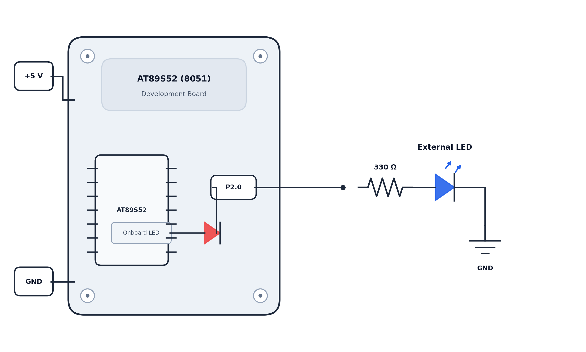

# CONTINUOUS ASSESSMENT 2: 8051 GPIO OUTPUT INTERFACING

**TARGET PLATFORM:** 8051 Microcontroller Architecture (AT89S52 / AT89C51)  
**ENVIRONMENT:** Keil µVision C51 Toolchain  

---

### Module Summary
This module demonstrates general-purpose digital input/output (GPIO) port configuration on the 8051 architecture. It covers bit-level Special Function Register (SFR) manipulation, active-low current sinking interfacing, and software delay generation using nested loop calibration.

### Interfacing Schematic

---

### Tasks Included
- **TASK 2B:** Bare-Metal LED Blinking with Software Delay Loop (`TASK2B/`)

---

### Build Steps

1. Launch Keil µVision and open the project file (`TASK2B/task.uvproj`).
2. Build the target firmware (Press `F7` or click **Project -> Build Target**).
3. Connect the hardware programming adapter (USBasp / ISP Programmer) to the development board ICSP header.
4. Download the compiled Intel HEX binary (`TASK2B/Objects/firmware.hex`) to the microcontroller flash memory (Press `F8` or flash via ProgISP).
5. Reset the board and verify that the LED toggles at a steady 1 Hz rate (500 ms ON / 500 ms OFF).
