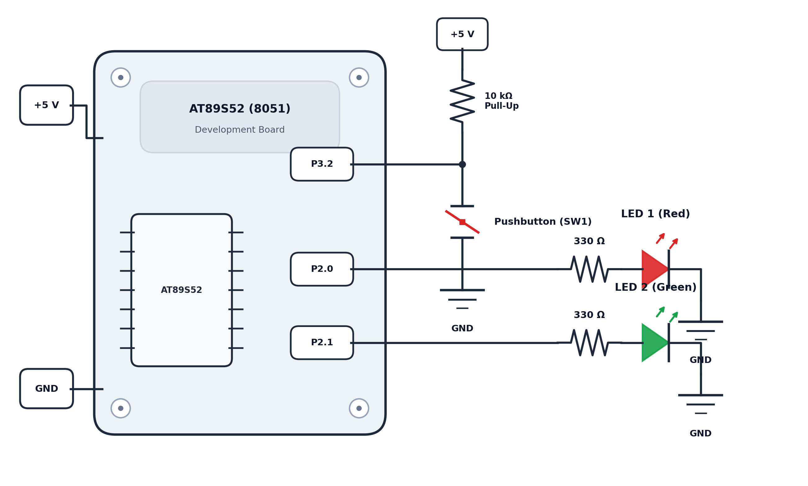

# CONTINUOUS ASSESSMENT 3: 8051 DIGITAL INPUT INTERFACING

**TARGET PLATFORM:** 8051 Microcontroller (AT89S52)  
**ENVIRONMENT:** Keil µVision C51 Toolchain  

---

### Module Summary
This experiment explores quasi-bidirectional input pin operation on the 8051 architecture. It covers the mandatory initialization step required to configure port pins as inputs (writing logic 1 to the latch), switch debounce timing, and conditional digital output steering.

### Interfacing Schematic

---

### Tasks Included
- **TASK 3A:** Pushbutton State Polling & Dual LED Interlocking Indicator (`TASK3A/`)

---

### Build Steps

1. Launch Keil µVision and open the project file (`TASK3A/task.uvproj`).
2. Build the target firmware (Press `F7` or click **Project -> Build Target**).
3. Connect the hardware programming adapter (USBasp / ISP Programmer) to the board.
4. Download the compiled Intel HEX binary (`TASK3A/Objects/firmware.hex`) to flash memory (Press `F8` or flash via ProgISP).
5. Verify on hardware: with switch released, Green LED2 stays ON; depressing switch SW1 immediately turns Red LED1 ON and Green LED2 OFF.
