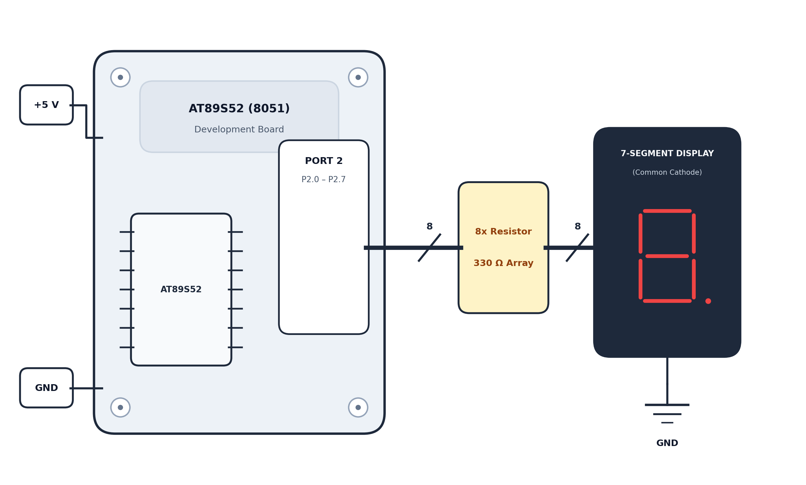

# CONTINUOUS ASSESSMENT 4: 8051 7-SEGMENT DISPLAY DRIVER

**TARGET PLATFORM:** 8051 Microcontroller (AT89S52)  
**ENVIRONMENT:** Keil µVision C51 Toolchain  

---

### Module Summary
This experiment implements a decimal 0–9 decade counter driving a Common Cathode (CC) 7-segment display. It demonstrates bus-width byte transfers on Port 2, ROM-based lookup table (LUT) array indexing, and calibrated software pacing.

### Interfacing Schematic

---

### Tasks Included
- **TASK 4A:** Common Cathode 0–9 Decade Counter via Port 2 Bus (`TASK4A/`)

---

### Build Steps

1. Launch Keil µVision and open the project file (`TASK4A/task.uvproj`).
2. Build the target firmware (Press `F7` or click **Project -> Build Target**).
3. Connect the hardware programming adapter (USBasp / ISP Programmer) to the ICSP header.
4. Download the compiled Intel HEX binary (`TASK4A/Objects/firmware.hex`) to the microcontroller flash memory (Press `F8` or flash via ProgISP).
5. Power cycle / reset the board and confirm that the 7-segment display cycles smoothly from digit `0` through `9` at 1-second intervals.
