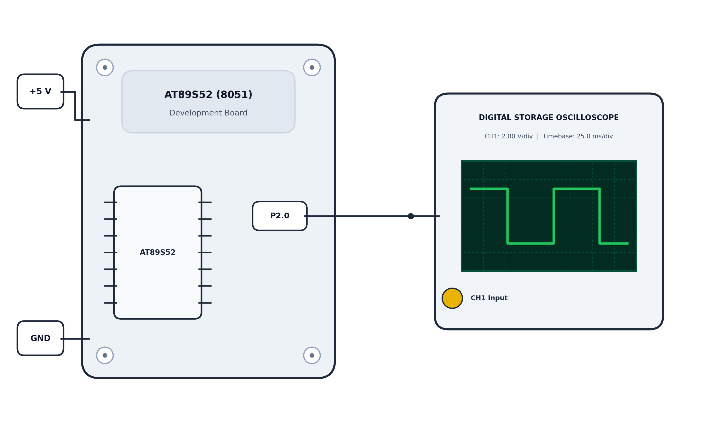

# CONTINUOUS ASSESSMENT 5: 8051 HARDWARE TIMER DELAY & WAVEFORM SYNTHESIS

**TARGET PLATFORM:** 8051 Microcontroller (AT89S52)  
**ENVIRONMENT:** Keil µVision C51 Toolchain  

---

### Module Summary
This experiment explores the on-chip hardware timers of the 8051 architecture. It demonstrates Timer 0 configuration in 16-bit non-auto-reload mode (Mode 1), precise delay synthesis independent of CPU execution jitter, and square-wave signal generation.

### Interfacing Schematic

---

### Tasks Included
- **TASK 5A:** 50 ms Delay & 10 Hz Symmetrical Square Wave Generation (`TASK5A/`)
- **TASK 5B:** Timer 0 Mode 1 Periodic Delay Module (`TASK5B/TASK5B.1/`)

---

### Build Steps

#### For TASK 5A (50 ms / 10 Hz Waveform):
1. Launch Keil µVision and open `TASK5A/task.uvproj`.
2. Build the target firmware (Press `F7` or click **Project -> Build Target**).
3. Connect the USBasp programmer to the development board ICSP header.
4. Download the compiled Intel HEX binary (`TASK5A/Objects/firmware.hex`) into flash memory (Press `F8` or flash via ProgISP).
5. Attach an oscilloscope probe to pin `P2.0` and ground clip to `GND`. Verify a clean 10.0 Hz square wave (50 ms HIGH, 50 ms LOW) on the display.

#### For TASK 5B.1 (20 ms Periodic Delay):
1. Launch Keil µVision and open `TASK5B/TASK5B.1/task.uvproj`.
2. Build the target firmware (Press `F7`).
3. Connect the USBasp programmer and flash `TASK5B/TASK5B.1/Objects/firmware.hex`.
4. Verify on an oscilloscope or frequency counter that pin `P2.0` oscillates at exactly 25.0 Hz with a 20.0 ms half-period.
