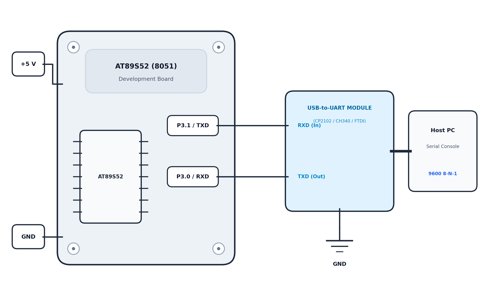

# CONTINUOUS ASSESSMENT 6: 8051 FULL-DUPLEX UART COMMUNICATION

**TARGET PLATFORM:** 8051 Microcontroller (AT89S52)  
**ENVIRONMENT:** Keil µVision C51 Toolchain  

---

### Module Summary
This experiment establishes asynchronous serial telemetry communication between the 8051 microcontroller and a host computer terminal. It covers Timer 1 Mode 2 auto-reload baud rate synthesis, UART Mode 1 framing (8-N-1 at 9600 baud), `SBUF` buffer management, and string transmission protocols.

### Interfacing Schematic

---

### Tasks Included
- **TASK 6A:** Full-Duplex UART Serial Transmitter at 9600 Baud (`TASK6A/`)

---

### Build Steps

1. Launch Keil µVision and open the project file (`TASK6A/task.uvproj`).
2. Build the target firmware (Press `F7` or click **Project -> Build Target**).
3. Connect the USBasp programmer and flash the target firmware (`TASK6A/Objects/firmware.hex`) onto the MCU (Press `F8` or flash via ProgISP).
4. Connect the USB-to-UART module (CP2102/CH340) to the PC USB port and identify the COM port in Device Manager.
5. Launch a serial terminal (PuTTY or Serial Monitor), select the COM port, set Baud Rate to `9600`, Data Bits `8`, Stop Bits `1`, Parity `None`, and open the session.
6. Verify reception of continuous ASCII telemetry packets: `"Telemetry Packet: Status OK, MCU Active."` at 1-second intervals.
