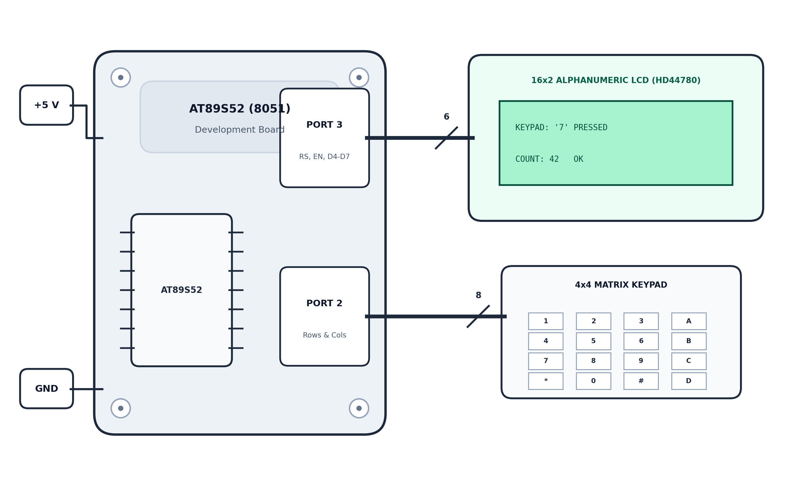

# CONTINUOUS ASSESSMENT 7: 8051 LCD & KEYPAD HMI SUBSYSTEM

**TARGET PLATFORM:** 8051 Microcontroller (AT89S52)  
**ENVIRONMENT:** Keil µVision C51 Toolchain  

---

### Module Summary
This experiment develops a complete Human-Machine Interface (HMI) subsystem for the 8051 architecture. It demonstrates:
1. 4-bit bus multiplexed interfacing with an industry-standard HD44780 16x2 alphanumeric LCD.
2. Dynamic DDRAM addressing for cursor management and real-time numerical counter telemetry.
3. Matrix row-column scanning, contact debouncing, and keypad coordinate encoding on a 4x4 matrix keypad.

### Interfacing Schematic

---

### Tasks Included
- **TASK 7A:** HD44780 16x2 LCD Initialization & Alphanumeric String Rendering (`TASK7A/`)
- **TASK 7B:** Dynamic Decimal Telemetry Counter & DDRAM Cursor Steering (`TASK7B/`)
- **TASK 7C:** 4x4 Matrix Keypad Scanning with Real-Time LCD Visual Feedback (`TASK7C/`)

---

### Build Steps

#### For TASK 7A (16x2 LCD Text String Display):
1. Launch Keil µVision and open `TASK7A/task.uvproj`.
2. Build target firmware (Press `F7` or click **Project -> Build Target**).
3. Connect USBasp programmer to the ICSP header.
4. Flash the binary `TASK7A/Objects/firmware.hex` (Press `F8` or flash via ProgISP).
5. Adjust the 10 kΩ contrast trimpot until text characters appear sharply on Lines 1 and 2.

#### For TASK 7B (Real-Time Dynamic Counter):
1. Launch Keil µVision and open `TASK7B/task.uvproj`.
2. Build target firmware (Press `F7`).
3. Download `TASK7B/Objects/firmware.hex` to flash memory.
4. Verify the LCD: confirm the counter updates from `00` to `99` every 500 ms with zero display flicker.

#### For TASK 7C (4x4 Matrix Keypad Scanner):
1. Launch Keil µVision and open `TASK7C/task.uvproj`.
2. Build target firmware (Press `F7`).
3. Download `TASK7C/Objects/firmware.hex` to flash memory.
4. Press individual keys on the 4x4 keypad (`0`-`9`, `A`-`D`, `*`, `#`) and verify that pressed characters immediately render on the LCD.
