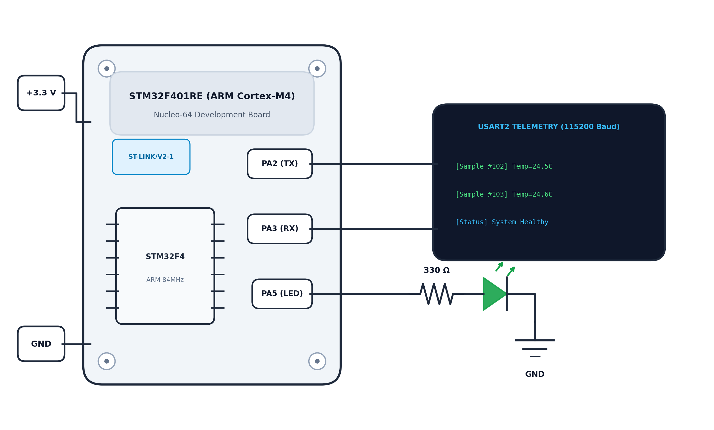

# CAT 11: STM32 USART Telemetry & Peripheral Drivers

## Overview
Continuous Assessment 11 demonstrates serial telemetry communication on STM32 ARM Cortex-M4 utilizing the USART2 peripheral interface at 115200 baud with periodic system heartbeat monitoring.

### Build Steps
1. Open the STM32CubeIDE project (`project_name.ioc` or open the `Core/` folder).
2. Build the firmware (Project → Build All or press **F7**).
3. Connect the ST‑Link programmer or USB‑ASP.
4. Flash the binary (`Debug/firmware.elf` or `firmware.bin`) via the IDE (Run → Debug).
5. Reset the board and verify the behavior described in the task.

**STUDENT REGISTER NO:** 25011102043

---

### Subtasks Index
- [TASK11A](TASK11A/): STM32 USART2 Telemetry Stream & System Heartbeat
