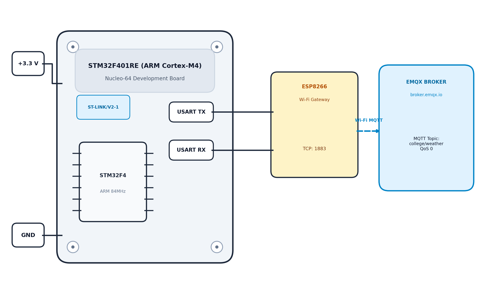
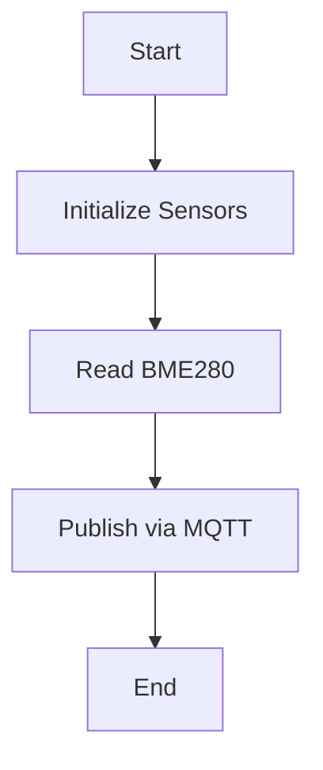

# CAT 13: MQTT Protocol & Cloud Telemetry

## Overview
Continuous Assessment 13 explores cloud messaging protocols for IoT edge systems using MQTT over TCP/IP via the ESP8266 Wi-Fi transceiver interfaced with the STM32 ARM Cortex-M4 microcontroller.

### Build Steps
1. Open the STM32CubeIDE project (`project_name.ioc` or open the `Core/` folder).
2. Build the firmware (Project → Build All or press **F7**).
3. Connect the ST‑Link programmer or USB‑ASP.
4. Flash the binary (`Debug/firmware.elf` or `firmware.bin`) via the IDE (Run → Debug).
5. Reset the board and verify the behavior described in the task.

**STUDENT REGISTER NO:** 25011102043

### Flowchart Diagram

---

### Subtasks Index
- [TASK13](TASK13/): MQTT Protocol Telemetry Publisher via ESP8266 Wi-Fi
