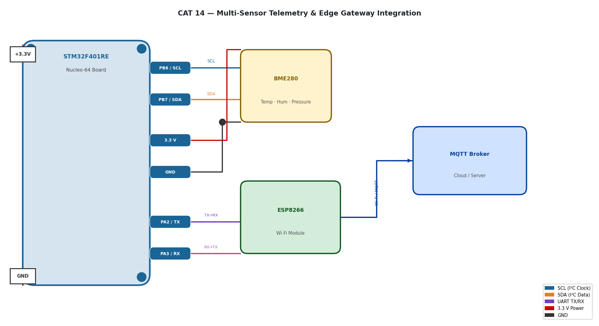
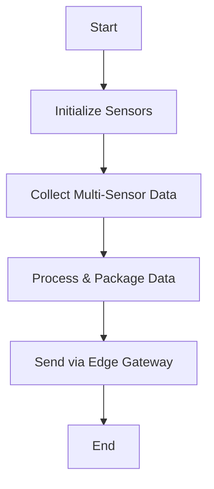

# CAT 14: Multi-Sensor Telemetry & Edge Gateway Integration

## Overview
Continuous Assessment 14 demonstrates the integration of multiple sensor interfaces (I2C) with high-speed serial transceivers on the STM32 ARM Cortex-M4 platform to establish an embedded edge telemetry gateway.

### Build Steps
1. Open the STM32CubeIDE project (`TASK14/` or the `Core/` folder).
2. Build the firmware (Project → **Build All** or press **F7**).
3. Connect the ST‑Link programmer or USB‑ASP.
4. Flash the binary (`Debug/firmware.elf` or `firmware.bin`) via the IDE (Run → **Debug**).
5. Reset the board and verify the behavior described in the task.

**STUDENT REGISTER NO:** 25011102043

### Flowchart Diagram

---

### Subtasks Index
- [TASK14](TASK14/): Multi-Sensor Telemetry & Edge Gateway Integration
