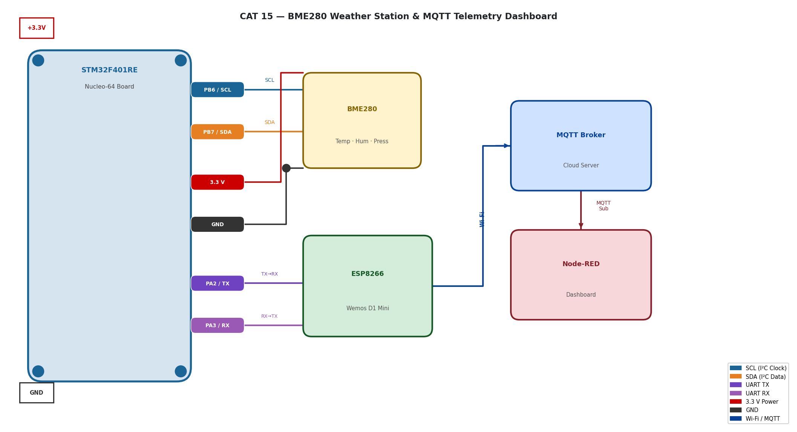

# CONTINUOUS ASSESSMENT 15

## STM32 Weather‑Station / BME280 Telemetry

### Overview
This folder contains the firmware, STM32CubeIDE project and hardware documentation for the final assessment (CAT 15). The experiment reads temperature, humidity and pressure from a BME280 sensor via I2C and publishes the data over MQTT (through an ESP8266 module).

---

### Build Steps
1. Open the STM32CubeIDE project (`TASK15/IOT_project.ioc` or the `Core/` folder).
2. Build the firmware (Project → **Build All** or press **F7**).
3. Connect the ST‑Link / USB‑ASP programmer.
4. Flash the binary (`Debug/firmware.elf` or `firmware.bin`) via the IDE (Run → **Debug**).
5. Reset the board and verify the sensor output as described in the task.

**STUDENT REGISTER NO:** 25011102043
