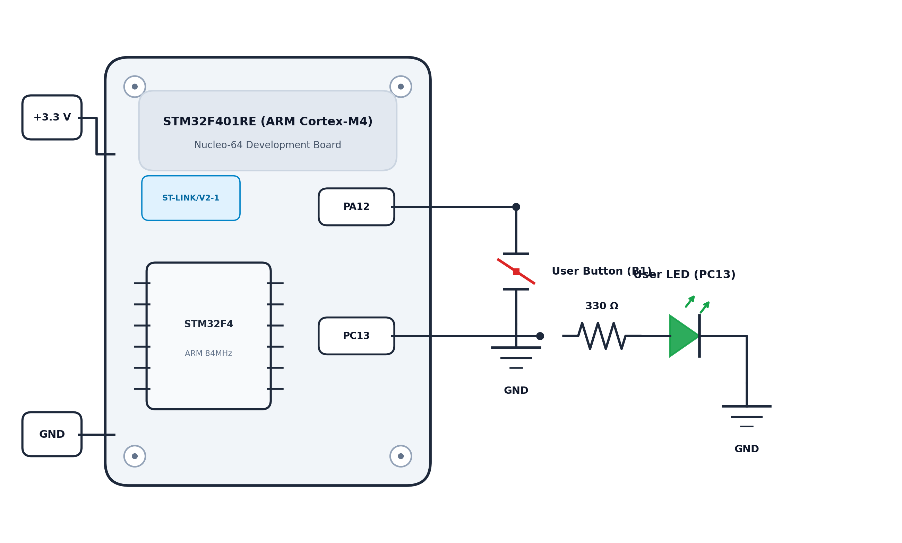

# CONTINUOUS ASSESSMENT 8

## STM32 GPIO Bring-Up & Switch-Controlled LED

**STUDENT REGISTER NO:** 25011102043  

---

### Overview
This folder contains the practical implementations, firmware source code, Keil/STM32CubeIDE projects, and hardware documentation for STM32 GPIO Bring-Up & Switch-Controlled LED.

### Circuit Schematic

### Build Steps
1. Open the STM32CubeIDE project (`project_name.ioc` or open the `Core/` folder).
2. Build the firmware (Project → Build All or press **F7**).
3. Connect the ST‑Link programmer or USB‑ASP.
4. Flash the binary (`Debug/firmware.elf` or `firmware.bin`) via the IDE (Run → Debug).
5. Reset the board and verify the behavior described in the task.

**STUDENT REGISTER NO:** 25011102043

---

### Subtasks Index
Please refer to the subtask directories for individual source code, compilation targets, and technical reports.

